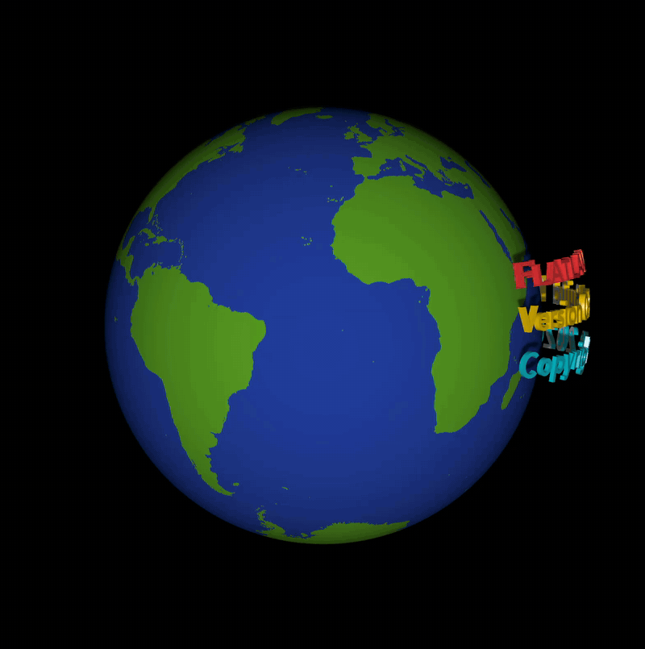
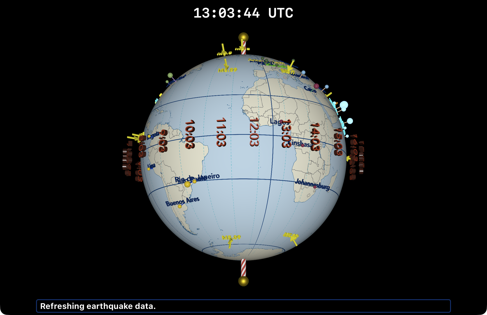
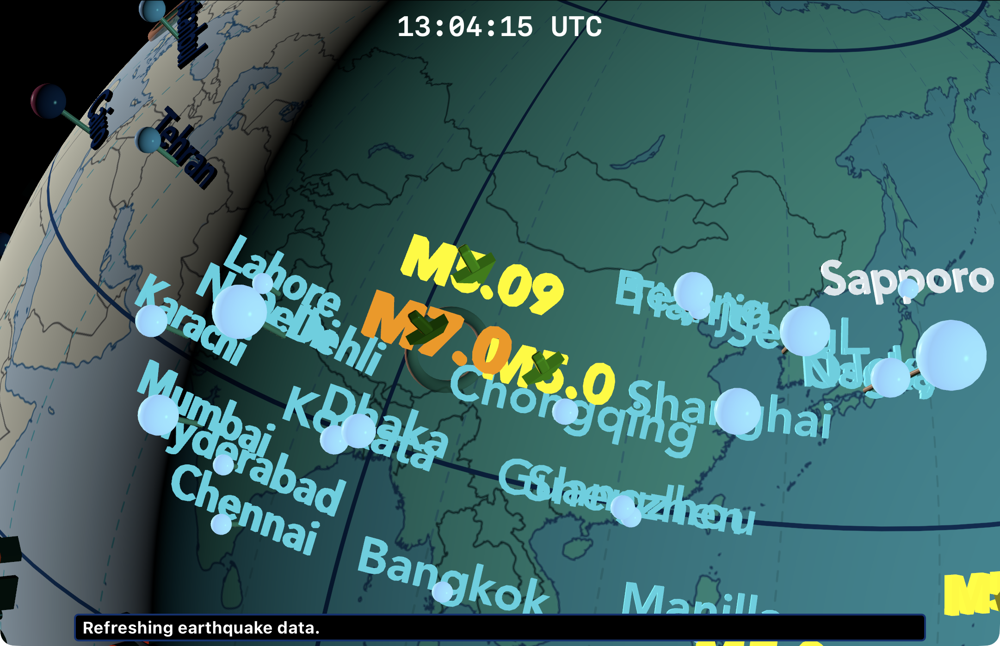
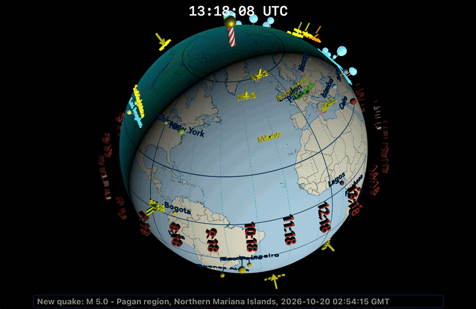
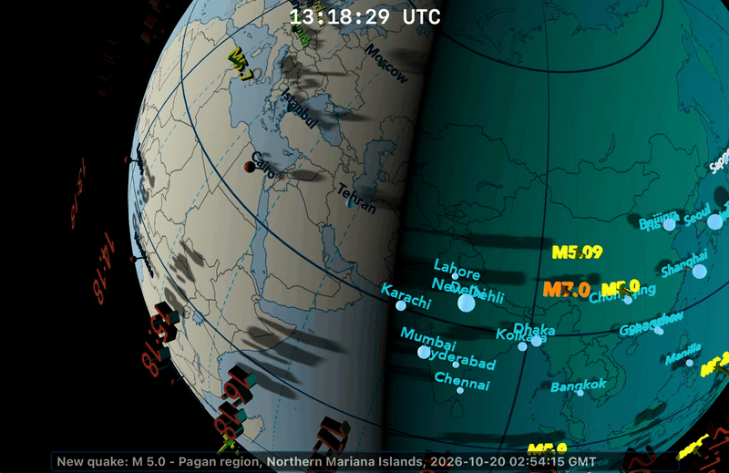
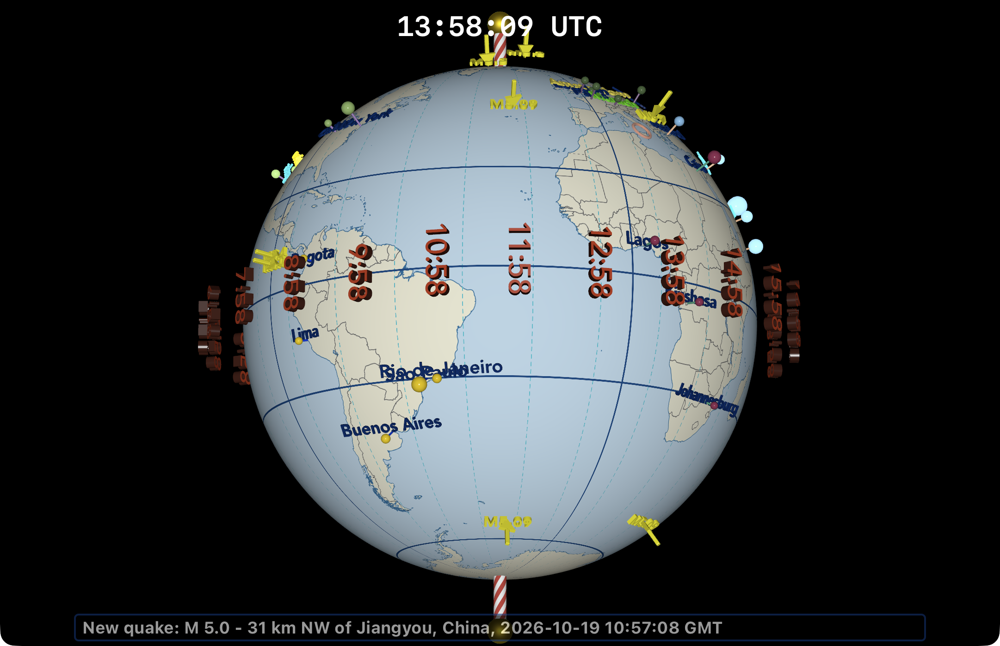
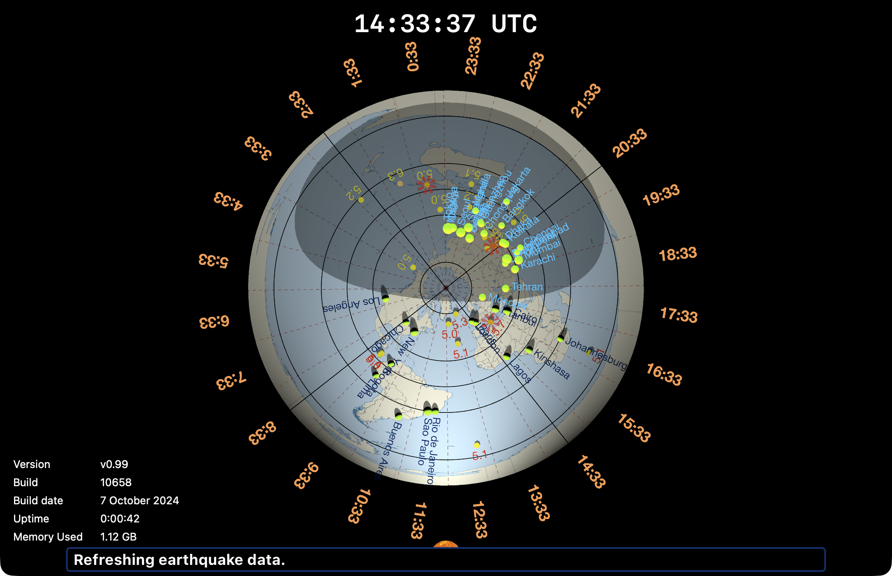
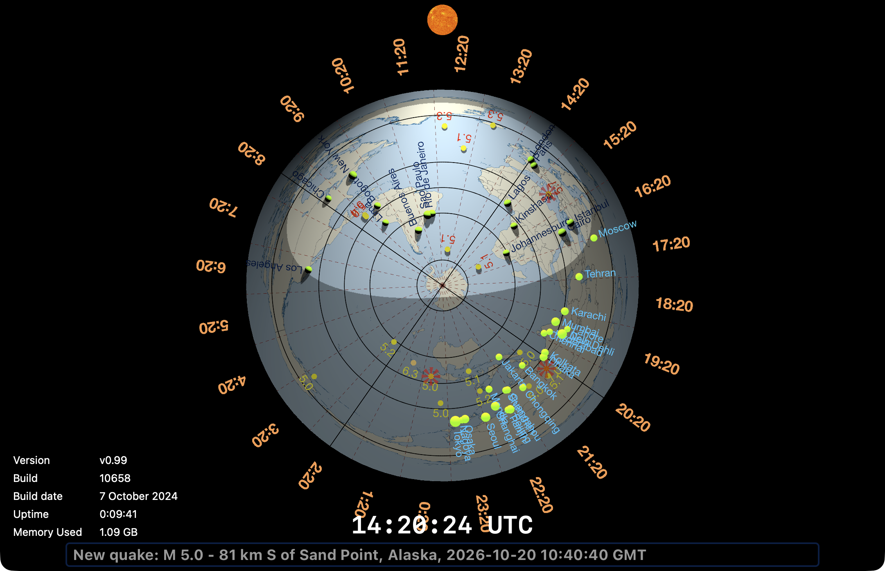
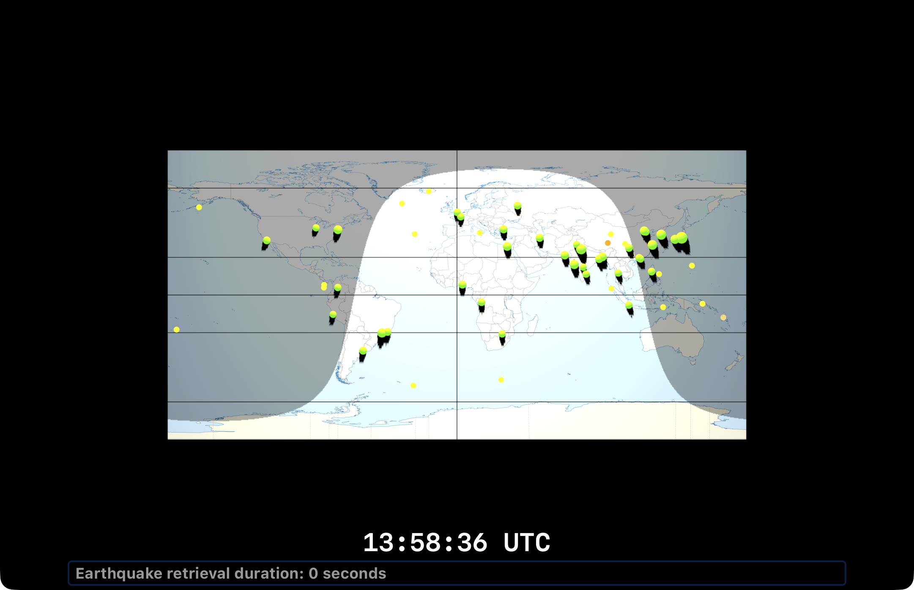

# FlatlandView
Stuart Rankin\
2019 - 2026

## Summary
Desktop version of Flatland

Flatland supports various geometries, such as the expected sphere, but also cubicle and other shapes. This is Flatland's About view.\

To help resolve issues in the mobile version of Flatland, I wrote a desktop version using the mobile version as a template, but mostly from scratch given the subtle differences between mobile and desktop in SceneKit and other SDKs.

The desktop version has taken on a life of its own and is now more complex and functional than the mobile version, which I haven't touched for a while. 

Flatland was written by Stuart Rankin with design inspiration and assistance from Kees de Kok.

## Note

When downloading the source code, take care to ensure the compile-time script has the proper paths or the compile will fail. Alternatively you can disable that particular build phase.

## Legal

FlatlandView (also referred to as Flatland) is copyright 2020 by Stuart Rankin.

All images used in Flatland, are to the best of my knowledge, in public domain.
All sounds used in Flatland, are to the best of my knowledge, in public domain.

## Purpose

Flatland's original purpose was to show night and day on a flat map of the Earth. To more more efficient use of mobile devices, I used a polar-projected equirectangula map for the 2D mode.
Later, I added a 3D mode which the user can see day and night as he spins the globe.

Representative of Flatland's initial view on startup.\

Zoomed view of Flatland with day to the left and night to the right.\

## Features

* 2D: 
  * Show a 2D polar-projected equirectangular map (either north-centered or south-centered) with day and night plotted on top of it.
  * Show day and night with a dark area representing night. This area is appropraite for the date the user is viewing Flatland.
  * Show cities from a set of pre-loaded cities.
  * Show locations the user specifies.
  * Show earthquakes according to a user-defined earthquake filter.
  
* 3D:
  * Show equirectangular maps (of various types) projected onto a 3D sphere.
  * The sphere is oriented according to the season such that the proper parts of the Earth are illuminated by the sun. (The dark side is illuminated by a moon light.)
  * Show cities from a set of pre-loaded cities.
  * Show locations the user specifies.
  * Show regions the user specifies.
  * Show earthquakes according to a user-defined earthquake filter.

Animation of Flatland seen zoomed out.\

Animation of Flatland zoomed in. Shadows appear at closer zoom levels.\

  
* Asynchronous:
  * Earthquakes are retrieved from the USGS once a minute and are grouped by location (to prevent data overload). Additionally, the user may specify a set of filters to determine which earthquakes are displayed.
  * Certain map types download the most recent satellite data available from NASA (where "most recent" means within the last 36 hours to avoid areas of no coverage).
    * Satellite images are downloaded tile-by-tile and reassembled in Flatland into a equirectangular map that is projected onto the 3D sphere.
    * Most satellites have gaps in coverages over the course of a day - these gaps will appear as diagonal, black regions.
    * Usually, the north polar area is black in winter, and the south polar area is black in winter.

## Geometries
Flatland supports the following geometries for showing the Earth:
### Spherical
This is the expected type of geometry with the Earth represented as a sphere.\

### Cubicle
Currently, this version of Flatland only uses the cubic map for the About screen. Adding it as a "normal" map is straightfoward.
### Flat Polar
There are two flat polar maps - north centered and south centered.\

### Equirectangular
This is close to what people think of as maps - rectangular with lots of distortion around the poles.\
\
(A bug is present in this projection - the light is too bright...)

## Implementation

FlatlandView is implemented with Swift for macOS, with some code in C++/Metal shader language (<1%) for optimization. Flatland does not use any third-party frameworks or plug-ins.

Asynchronous data is requested and received via standard AppKit function calls.

Flatland makes extensive use of threading for:
  1. Asynchronous data retrieval. Flatland is designed to receive data late, or not at all, and still function properly. For now, all asynchronous data Flatland requests and receives is non-critical to the functioning of the program.
  2. Slow operations are run on background threads (and/or make use of GPU Metal shaders). Flatland is designed to fallback to default values until the slower values are ready for use.

Imagery
  * Flatland makes extensive use of imagery, especially maps of the world.
    * All maps used by Flatland _in 3D mode_ **_must_** be in equirectangular format (2:1 length to height ratio).
      * Maps used for 2D mode must start as equirectangular and be converted to polar coordinates. Most maps for 2D mode were created as a pre-compilation step. Eventually, this will be done internally.
    * Most maps supplied with Flatland are 3600x1800 in size. This seems to be a good resolution when not zoomed too closely. Large sized images will increase the Flatland binary excessively.
  * Flatland has many maps compiled into its resource fork and has preliminary work done for loading maps defined by customers.
    * Eventually Flatland will convert equirectangular images to polar-projected maps for 2D mode.
  * A day/night mask overlay was created for each day of the year for both north-centered and south-centered projections for 2D mode.
  * Most 3D imagery is generated in Flatland at run-time - specifically shapes and the like.
  

